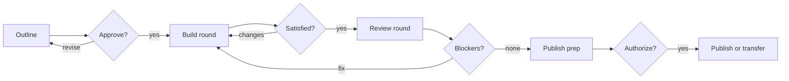

Design, build, review, and publish GitHub Skills-style exercises with one coordinating agent and five Agent Skills for learner journeys, workflow-backed validation, and release readiness.

## Installation

### Copilot CLI

Install directly from this repository:

```shell
copilot plugin install arilivigni/gh-skills-builder
```

> [!WARNING]
> Copilot CLI currently supports direct repository installs but marks them as deprecated. Keep this path as a fallback until this plugin is indexed in a marketplace, then prefer `plugin@marketplace` installs.

Or from within an interactive Copilot session:

```
/plugin install arilivigni/gh-skills-builder
```

> [!NOTE]
> Installing from `arilivigni/gh-skills-builder` performs a direct repository install. You can verify the install with:
> ```shell
> copilot plugin list
> ```
> After install, manage the plugin by name (`gh-skills-builder`) for update and uninstall commands.

To update to the latest version:

```shell
copilot plugin update gh-skills-builder
```

To remove the plugin:

```shell
copilot plugin uninstall gh-skills-builder
```

### Copilot App

1. Open the Copilot App and go to **Plugins**.
2. Select **Add plugin**, then provide `arilivigni/gh-skills-builder`.
3. Confirm install, then enable the plugin for your chat/session.

> [!TIP]
> If you prefer VS Code, open the Command Palette (`⌘⇧P` / `Ctrl+Shift+P`), run **Chat: Plugins**, then install **gh-skills-builder** from the plugin picker.

## Plugin format

Starting with 3.0.1, the package follows [Agent Plugins v1.0.0](https://agent-plugins.org/specification).
Root `plugin.json` contains metadata and the canonical `$schema`, without legacy `agents` or `skills`
arrays. Skills are discovered from `skills/*/SKILL.md`. The orchestrator is a Copilot-specific component
in `com.github.copilot/agents/`, following the
[Copilot CLI plugin reference](https://docs.github.com/en/copilot/reference/copilot-cli-reference/cli-plugin-reference#components).

Use a Copilot client that supports Agent Plugins v1.0.0. The plugin, agent, and five skill names are
unchanged from 3.0.0. Other Agent Plugins clients can discover the skills but may ignore the Copilot agent.

## What's Included

### Agent

| Agent | Mention | Role | Tool Access |
| --- | --- | --- | --- |
| **Orchestrator** | `@github-skills-orchestrator` | Runs the full lifecycle as an approval-gated loop, checking in with you after every build round and every review round. | Full coding and test tools |

The orchestrator loads the relevant skill for each phase. Skills own stage-specific requirements; the agent
keeps sequencing, approval gates, and publication authorization explicit.

> [!IMPORTANT]
> Review reports findings and stops before fixes. This is a behavioral rule, not a restricted tool-permission
> boundary: the orchestrator still has edit tools. Reviewing its own work is not independent review. If you
> need independent review or enforced restricted access, arrange it separately.

**Migrating to 3.0:** The five lifecycle skills now share the `github-skills-` prefix. Update saved prompts,
scripts, and documentation that invoke them by name. The old names have no aliases, and an installed 2.x copy
keeps the old names until you update the plugin. The `@github-skills-orchestrator` agent and the
`gh-skills-builder` plugin name are unchanged.

| 2.x skill | 3.0 skill |
| --- | --- |
| `/orchestrate-github-skills-exercise` | `/github-skills-orchestrate` |
| `/create-github-skills-outline` | `/github-skills-outline` |
| `/bootstrap-github-skills-exercise` | `/github-skills-bootstrap` |
| `/review-github-skills-exercise` | `/github-skills-review` |
| `/publish-github-skills-exercise` | `/github-skills-publish` |

**Migrating to 2.0:** The four specialist agent entry points have been removed. Replace their mentions with
`@github-skills-orchestrator` and invoke the corresponding phase skill, as shown below. Skill names did not
change in 2.0; they were renamed in 3.0.

### Skills

The plugin provides five lifecycle skills:

- `/github-skills-orchestrate` — run the whole loop with approval gates between every round.
- `/github-skills-outline` — design a new exercise or convert training material into a self-paced GitHub Skills outline, including an eye-catching title and repository name candidates approved at Gate 1.
- `/github-skills-bootstrap` — create the repository shell (saved outline in `.github/exercise-outline.md` plus a README stub with the approved name and the Copy Exercise badge), then `0-start-exercise.yml`, numbered step Markdown and workflows ending in `x-review.md`, validation scripts, and starter structure, checked with the template contract's pre-handoff checks.
- `/github-skills-review` — audit an exercise for learner experience, step and activity consistency, template parity, validation correctness, workflow safety, accessibility, and readiness, ranking findings with a severity guide.
- `/github-skills-publish` — prepare final checklist, release notes, PR copy, validation evidence, and publish or transfer guidance, defaulting the target to the approved repository name while still requiring explicit authorization.

### Template contract reference

`skills/github-skills-bootstrap/references/exercise-template-contract.md` captures the concrete
conventions implemented by [`skills/exercise-template`](https://github.com/skills/exercise-template) and
[`skills/exercise-toolkit`](https://github.com/skills/exercise-toolkit): canonical file names, workflow
skeletons, reusable workflow inputs and outputs, action pins, workflow enable/disable chaining, permission
matrix, grading job shape, and the README, step, and review Markdown skeletons. It also defines the step
and activity rules, activity badge blocks, template variables in step content, the Copy Exercise badge and
README footer, and copy-ready pre-handoff checks. The orchestrator reads it through the bootstrap skill
before writing files, and the review skill runs the same checks.

## Quick Start

### Orchestrated (recommended)

```
@github-skills-orchestrator I want to build a GitHub Skills exercise that teaches [topic].
Use /github-skills-orchestrate and check in with me after every build and review round.
```

The orchestrator runs the four phases and stops at each gate:



### Phase by phase

#### 1. Create the exercise outline

```
@github-skills-orchestrator I want to teach [topic] as a 30-minute GitHub Skills exercise.
Use /github-skills-outline to define objectives, learner steps, and validation ideas.
```

#### 2. Bootstrap the repository

```
@github-skills-orchestrator Use the approved outline to scaffold the exercise.
Use /github-skills-bootstrap to create README content, steps, workflows, and validation guidance.
```

#### 3. Review before launch

```
@github-skills-orchestrator Review this exercise for learner clarity, validation reliability, workflow safety, and accessibility.
Use /github-skills-review, prioritize release blockers, and report findings without editing files.
```

#### 4. Prepare for publication

```
@github-skills-orchestrator Prepare this exercise for release.
Use /github-skills-publish to produce validation evidence, PR description, release notes, and remaining risks.
```

To publish into an organization or move an existing exercise between organizations:

```
@github-skills-orchestrator Use /github-skills-publish to plan a transfer of source-org/exercise-repo to dest-org/exercise-repo.
Wait for my explicit authorization before transferring, then fix the Copy Exercise badge afterward.
```

## How It Works

The plugin splits exercise creation into four focused phases so the human can approve the learning design before repository automation is generated:

- **Outline first** — define the learner outcome, scenario, exercise title, repository name, steps, and validation signals. Every step needs one Theory block and one or more Activity blocks, numbered when there are several.
- **Bootstrap second** — create or update repository assets only after the outline is approved, starting with the repository shell: the saved outline and a README stub carrying the approved title and name.
- **Review third** — catch weak validation, unsafe workflow behavior, unclear learner instructions, inconsistent step and activity structure, a broken Copy Exercise badge, and accessibility issues.
- **Publish last** — assemble release evidence and handoff notes for contribution, rollout, or org transfer.

The Orchestrator agent runs these phases as a loop with four gates and **stops for a user check-in after every
build round and every review round**, so work is never chained build → review → build without a user
check-in. Approved fixes run through the bootstrap skill; after build approval, the review skill is loaded
again before publication can proceed.

## Exercise conventions

Exercises generated by this plugin follow the [`skills/exercise-template`](https://github.com/skills/exercise-template) contract:

- `.github/workflows/0-start-exercise.yml` posts Step 1. After that,
  `.github/steps/N-step.md` ↔ `.github/workflows/N-step.yml` ↔ workflow `name: Step N`. The final workflow
  keeps the `N-step.yml` name, is named `Step N # Last step of the exercise`, and posts
  `.github/steps/x-review.md`.
- Only `Step 0` is enabled on a fresh copy; each step enables the next as the learner progresses.
- Every step starts with `## Step N:` and has exactly one `📖 Theory` block with real content. A step with
  one activity uses `### ⌨️ Activity:`; a step with several numbers them `### ⌨️ Activity 1:`,
  `### ⌨️ Activity 2:`, and so on.
- Every activity uses `1.`-numbered instructions and has its own `Having trouble? 🤷` block. The final
  activity ends with "Wait a moment for Mona to check your work, provide feedback, and share the next lesson."
- Copilot prompts and terminal commands inside an activity use badge-led blockquotes. Copilot Chat, app, and
  IDE prompts use the Prompt badge; prompts typed in a Copilot CLI session use the CLI Prompt badge; shell
  commands use the Terminal badge:

  > 
  >
  > ```prompt
  > Summarize the changes in this pull request.
  > ```

  > 
  >
  > ```prompt
  > Explain what this workflow does.
  > ```

  > 
  >
  > ```bash
  > gh repo view
  > ```

- The README has exactly one Copy Exercise button under `### How to start this exercise`, using the image
  from the [`skills/exercise-template` README](https://github.com/skills/exercise-template/blob/main/README.md)
  unchanged. Only its link parameters change: `template_owner`, `template_name`, `name=skills-<repository>`,
  `description=Exercise:+<Title>`, and `visibility`.

  

- The README ends with a `---` rule and a `&copy; <year> <holder>` footer that matches `LICENSE`.

## Companion Instructions

Agent Plugins v1.0.0 standardizes skills and MCP servers, with other components supplied through client
extensions. This plugin includes `instructions/github-skills-exercises.instructions.md` as an optional
companion file to copy into exercise repositories; it is not automatically loaded as plugin instructions.

## Evaluation

Test prompts are in `evals/evals.json`. They cover outline creation, exercise naming, bootstrap planning, quality review,
publish readiness, direct skill routing, report-only review and approved fix rounds, orchestrated loop
handling, org-to-org transfer, multi-activity steps that follow the template, and review findings for
inconsistent activities, badge blocks, and the Copy Exercise badge and footer. These prompts describe
behavioral expectations; they do not enforce permissions or establish independent review.

## Release process (SemVer)

This plugin follows strict semantic versioning:

| Change type | Version bump | Examples |
| --- | --- | --- |
| Breaking behavior or contract changes | **MAJOR** (`X.0.0`) | Renaming/removing expected capabilities or changing required usage patterns |
| New non-breaking capabilities | **MINOR** (`X.Y.0`) | Adding agents, skills, or non-breaking plugin features |
| Fixes and non-breaking maintenance | **PATCH** (`X.Y.Z`) | Bug fixes, docs updates, wording improvements |

### CI gate

`.github/workflows/plugin-ci.yml` runs on pull requests and pushes to `main` and validates:
- root `plugin.json` syntax, Agent Plugins v1.0.0 fields and schema identifier, and absence of legacy manifests
- Copilot agent discovery under `com.github.copilot/agents/` and skill discovery under `skills/`
- agent and skill frontmatter parsed as YAML, with non-empty top-level `name` and `description` strings (including indented, folded, and literal descriptions)
- local markdown links in `README.md`
- content consistency via `scripts/validate-content.py`
- packaging regression tests via `python3 -m unittest discover -s scripts -p 'test_*.py'`

### Content validation

`scripts/validate-content.py` guards the conventions this plugin teaches. Run it locally:

```shell
python3 -m pip install pyyaml
python3 scripts/validate-content.py          # offline checks
python3 scripts/validate-content.py --online # also verify the pinned toolkit tag resolves
python3 -m unittest discover -s scripts -p 'test_*.py'
```

It checks that:

| Check | Catches |
| --- | --- |
| Manifest format | Legacy manifest locations, a missing or incorrect schema identifier, unsupported top-level fields, or malformed metadata. |
| Agent frontmatter | Missing `name`/`description`, names that are not lowercase kebab-case, or names that disagree with the filename under `com.github.copilot/agents/`. |
| Lifecycle topology | Anything other than the single orchestrator and five lifecycle skills, obsolete specialist-agent mentions, or pre-3.0 skill names in maintained plugin content. A pre-3.0 name is allowed only on a line that also names its replacement, such as a migration table row. |
| Skill discovery | Missing `SKILL.md` files, missing skill metadata, or names that disagree with the immediate child directory under `skills/`. No manifest registration is needed. |
| Code fence balance | An unclosed fence that silently swallows the rest of a document. |
| YAML blocks | A workflow skeleton that does not parse. These get copy-pasted into real exercises. |
| Toolkit ref consistency | Mixed `skills/exercise-toolkit` refs, for example bumping nine of ten pins. |
| Contract self-consistency | The contract's own skeletons breaking the rules they teach: a step skeleton without exactly one Theory, consistent activity headings, `1.` instructions, a `Having trouble` block per activity, and the Mona line in the final activity; a README skeleton without one Copy Exercise badge and the footer; a final workflow without the last-step marker; or a missing required section. |
| Badge canonicalization | Restyled or recolored prompt, terminal, or Copy Exercise badges. |
| Badge blocks | A prompt or terminal badge split from its blockquote, missing the bare `>` line, using alt text other than `Static Badge`, or followed by the wrong fence language (`prompt` for Prompt and CLI Prompt, `bash` for Terminal). |
| Pinned tag resolves (`--online`) | Pinning a draft release, whose git tag does not exist and which breaks every generated workflow. |

### Deployment plan

1. Merge to `main` only after CI is green.
2. Bump root `plugin.json` to the intended release version **before** releasing, and confirm it:

   ```shell
   python3 scripts/validate-content.py
   grep '"version"' plugin.json
   ```

3. Validate install paths (use direct repo install as fallback until marketplace listing is available):

   ```shell
   copilot plugin install arilivigni/gh-skills-builder
   copilot plugin list
   ```

4. Release from `main` by dispatching the `Release` workflow. It tags and publishes for you:

   ```shell
   gh workflow run Release --ref main -f version=X.Y.Z
   ```

   Leave `version` blank to use the manifest value. The workflow refuses to run from any ref other than
   `main`, rejects a version that does not match `plugin.json`, then creates the annotated tag and the
   release with generated notes.

5. Verify the published release and that its tag resolves to the intended commit:

   ```shell
   gh release view vX.Y.Z --json tagName,isDraft,targetCommitish
   gh api repos/arilivigni/gh-skills-builder/git/ref/tags/vX.Y.Z --jq .ref
   ```

> [!IMPORTANT]
> Do not tag by hand. `git tag vX.Y.Z && git push` bypasses the workflow's version check, which is how
> `v1.0.3` shipped while `plugin.json` still read `1.0.2`. Releasing through the workflow makes that
> mismatch impossible.

> [!WARNING]
> Do not use the workflow's `draft` input for a normal release. A draft release has no git tag, so anything
> pinning `@vX.Y.Z` fails to resolve.
